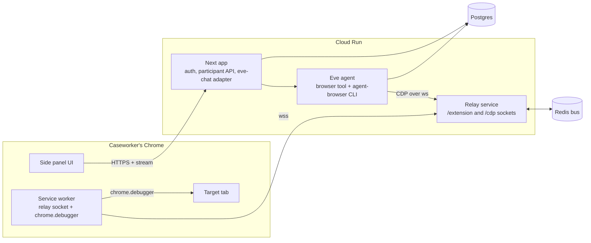

# Browser Extension (Design)

Status: draft for review
Date: 2026-10-23
Branch: `docs/browser-extension-design` (PR base: `browser-extension`)

## Intent

Let a caseworker use the existing form-filling agent from their own Chrome
instead of from the web app. They pick a site and a participant, press Start,
watch plain-language progress, check the filled form on the page, and submit it
themselves. The agent works in the caseworker's own tab, on any website they
point it at.

Why: the web app drives a remote browser (Kernel.sh) that the caseworker can
only watch through a live-view pane. Working in the real tab removes that
indirection, uses the caseworker's own signed-in sessions, and puts the filled
form where they already do their review and submission.

`browser-extension` is the long-lived integration branch for this work. `develop`
keeps the original web UI unchanged.

## Context

- Production chat runs on the legacy `streamText` route; the Eve agent
  (`agent/`) is the second implementation. **This work builds on Eve.**
- The agent's browser tool passes agent-browser CLI argv (`["fill","@e3","x"]`)
  straight to the CLI, which attaches to a Kernel browser over CDP. Prompts,
  skills and evals all assume that vocabulary.
- There is no participant database. `lib/data/participants.ts` holds records and
  `buildApplicationPrompt` turns one into the opening message.
- Eve runs as a sibling process in the same Cloud Run container as Next. Only
  Next's port is exposed. Eve's session continuity
  (`lib/ai/eve/session-continuity.ts`) is an in-memory `Map`, flagged in code as
  to be replaced by a Postgres-backed mapping.
- The app already uses shadcn components (zinc, `components/ui`), Tailwind
  tokens in `app/globals.css` (magenta `--primary`, accent `318 50% 93%`,
  `--radius: 0.75rem`), Geist, Inter on buttons, IBM Plex Mono for small action
  labels, and `lucide` icons. The tool-call cards use `rounded-xl border-accent`.

## Goals

1. Any caseworker can use it with no training: choose a site, choose a
   participant, Start, review, submit.
2. The agent fills forms in the caseworker's own tab on any HTTPS website.
3. The caseworker always knows what the agent is doing and can stop it.
4. Sensitive values never reach the model, the server, or the traces.
5. Reuse the agent stack as it is: Eve, the Eve prompts and skills, Jev,
   Braintrust tracing and evals.

## Non-Goals

- Submitting for the caseworker. The agent never clicks Submit.
- A public Chrome Web Store release. Distribution is private.
- Chat as the main interface.
- Replacing or changing the web app on `develop`.
- Supporting browsers other than Chrome.
- Replacing the Kernel path. It keeps serving the web app.

## Anti-Goals (failure even if it works)

- It is not secure.
- Users feel unsafe using it.
- It has a learning curve. Any screen that needs explaining should be
  simplified instead.

## Users and Flow

Users are caseworkers on the owner's team and partner teams, on a private
rollout. Six screens, drawn in the app's design language (mockups were reviewed
with the owner; this section is the spec).

1. **Home.** "Start a form." Two ways in: use the current tab, or pick from a
   configured list of common benefits sites, which the extension opens before
   starting. Shows recent runs.
2. **Participant, from the system.** Search by name or record ID against the
   participant API; select one.
3. **Participant, enter details.** A form for the caseworker's own data, plus
   "reuse saved details" at the top. See Saved Details.
4. **Ready.** A model picker and a plain summary of what the agent will do (work
   only on this site, ask for anything missing, stop before Submit). Start.
5. **Running** (below), then **Review** when the agent finishes.
6. **Confirmed.** Appears after the caseworker submits on the site. Shows the
   confirmation number if the page displays one. Actions: start another form
   for the same participant, or go back to Home.

### Running view

Not a chat. It shows participant and site, an elapsed timer, a progress bar with
"N of M fields" and "Section X of Y", and one card per form section.

- Finished sections collapse to one line with a count.
- The active section opens and lists what the agent just did, in the same
  small mono style as the existing tool-call cards.
- Waiting sections show muted.
- A **Needs you** card is pinned to the top whenever the agent needs input.
- A Stop button is always present.

Section names come from the form (headings, fieldsets). If a form has no clear
sections, fall back to one list of steps. (Owner-confirmed layout; the fallback
is a design call.)

### Needs You (missing data)

When the record lacks a value, the agent pauses on that item and keeps working on
others where possible. The card shows an input for the field.

- **Sensitive fields** (SSN, bank or account numbers, passwords, and similar) are
  masked, with an eye toggle. On "Fill it in" the extension types the value
  directly into the page through the debugger. The agent is told only
  "provided". The value is not sent to the server or model, is not stored, and
  is cleared from the panel after use. A second action lets the caseworker type
  it on the page themselves.
- **Ordinary fields** show a plain input. The value goes to the agent. A skip
  action is offered.

Owner decision: the agent must not see sensitive values.

### Review and Confirmed

When the agent finishes, the panel says "Ready for your review", lists anything
left for the caseworker, and offers "Show me the unfilled field" and "What the
agent did" (full action list). The caseworker submits on the site. The extension
detects the submission and moves to Confirmed.

Submit detection: observe the page's submit event or a click on a submit-type
control, followed by navigation or a changed DOM, using debugger events. A
manual "I submitted it" button is the fallback. Not tested on real sites.

## Architecture

### Extension

Manifest V3. A side panel (UI), a service worker that owns the relay WebSocket
and `chrome.debugger`, and no content scripts unless the builder finds a need.
The side panel is a separate small app in the repo that talks to the Next app's
API; it reuses the repo's Tailwind tokens and shadcn components through shared
configuration, not by importing from the Next tree. The socket lives in the
service worker, so a run continues if the panel closes, and the panel restores
its state when reopened.

### Relay service

A new, separate Cloud Run service (Node), because the app's container exposes one
port and Next cannot host WebSocket upgrades. It exposes `/extension` (the
caseworker's service worker) and `/cdp` (agent-browser, called from the Eve
process) and presents a browser-level CDP endpoint backed by `chrome.debugger`.
Any relay instance accepts either socket; instances route to the one holding the
extension's socket over a Redis pub/sub bus (verified locally with two
instances). The relay is the only component that touches CDP.

The spike (`spike/cdp-relay/`) is a working reference for the protocol shim:
`Target.*` handling, session multiplexing, re-attach on new client, child-session
forwarding. It is not production code.

### Eve agent

- The Eve `browser` tool keeps the same input schema and prompts. Instead of
  creating a Kernel browser, it runs agent-browser with `--cdp <relay /cdp URL>`
  for the run's session. This drops the Kernel import chain and the
  `server-only` bundling problem in `lib/kernel/eve-browser.ts` for this path.
- Missing-data requests use Eve's built-in human-in-the-loop (`ask_question`,
  `input.requested`, `session.waiting`, answered with `inputResponses`). The
  panel renders the request as the Needs You card. For sensitive fields the
  answer carries only "provided".
- Per-session continuity moves from the in-memory `Map` to Postgres. Extension
  runs are long and must survive instance restarts.
- Extension-specific behavior (scope rules, needs-you questions) is added to the
  Eve instructions and skills only. The legacy prompt tree is not touched.
- The `check_submit_gate` tool force-enables submit buttons and can invoke a
  Turnstile callback. It is not enabled for the extension. The caseworker
  handles a disabled submit button.

### Next app additions

- Participant API: search and fetch by ID, authenticated. Backed by a mock table
  on Neon seeded from `lib/data/participants.ts`, behind an interface so a real
  source can replace it without extension or agent changes. Records are fetched
  per run and not persisted by the extension.
- Run endpoint(s) that adapt the Eve stream for the panel (extending the
  existing `eve-chat` adapter), including a way to answer `input.requested`.
- A token-minting endpoint for the relay (see Security).
- Configuration endpoints for the site list and the allowed model list.

## Security Requirements

These are requirements, not suggestions. The agent acts without per-step
approval, so these controls are the safety net.

1. **Origin lock.** A run is bound to the origin it started on. Every command is
   checked against the tab's current URL. Navigation or new tabs outside the
   origin are blocked. If the tab leaves the origin, the run stops and the panel
   says why. HTTPS only.
2. **Tab scope.** The relay exposes only the one tab the run started on. Fail
   closed: with no configured origin, nothing is exposed.
3. **CDP method allowlist.** The extension forwards only an explicit set of CDP
   methods derived from what agent-browser actually sends, deny by default.
   Cookies, storage, `Fetch.*`, `Target.*` (beyond what the relay needs), and
   download behavior are denied. Child (iframe) sessions are checked against
   their own target URL, with a policy for which cross-origin frames are allowed
   (for example an embedded captcha).
4. **Authentication.** The relay accepts a short-lived token minted by the Next
   app after the caseworker signs in, scoped to one run and one tab, with an
   expiry. Not a shared secret. The relay also enforces `Origin` rules (the
   extension's exact ID, pinned with a manifest `key`; no browser `Origin` on
   `/cdp`), a `Host` allowlist, and never returns a token in an HTTP response.
5. **Final submit is human.** No code path clicks a submit control on the
   caseworker's behalf.
6. **Sensitive values.** Never reach the model, the server, Eve state, or traces.
   Eve persists everything the agent sees, so this is checked end to end. This
   is a hard guarantee (owner decision), implemented as described in Sensitive
   Value Redaction.
7. **Traces.** Participant values are scrubbed from Braintrust spans for the
   extension path. The builder confirms what current traces contain and matches
   or improves on it.
8. **Audit.** Each run records which commands ran against which origin.
9. **Stop.** A Stop control is always present and ends the run, detaches the
   debugger, and closes the relay session.
10. **Install.** Private managed install; the extension is not listed publicly.

## Sensitive Fields

Classification uses field type (`type=password`, autocomplete hints) and label,
plus a fixed question in `lib/jev/questions.ts` in the existing style (written
in code, versioned, regression-scored; the model does not author it). A
classification miss must fail toward "sensitive". The list of categories is
decided with the owner (see Open Items).

## Sensitive Value Redaction

Owner decision: a hard guarantee that the agent never sees a sensitive value.
Redaction runs **in the extension's service worker**, on every CDP response,
before it is sent up the relay socket. It cannot run in the relay: the relay is
server-side and must never see the value.

What the extension does:

1. **Field masking.** In snapshot (accessibility tree) and DOM responses, the
   value of any field classified as sensitive (see Sensitive Fields) is replaced
   with a fixed mask. The agent can still tell the field is filled or empty.
2. **Known-value scrubbing.** The extension keeps, in memory only, every
   sensitive value it typed during the run and removes any occurrence of it from
   every response, including digits-only and formatted variants. The values are
   cleared when the run ends.
3. **Screenshots.** Before a screenshot is taken, sensitive fields are visually
   masked on the page and restored afterward. If masking cannot be applied, the
   screenshot is refused.
4. **Records.** Sensitive fields are stripped from participant records
   server-side before the opening message is built. The agent gets a placeholder.

What the Eve `browser` tool layer does on this path (the server sees the
agent's argv, so it can refuse commands before they reach the browser):

- `eval`, and `get` of values, text or HTML, are refused. They are the commands
  that can return arbitrary page content, and a response filter cannot cover
  arbitrary JavaScript. The agent verifies a filled value from the masked
  snapshot instead.
- Refused commands return a short message the agent can act on. The Eve
  instructions and skills for this path are updated to match, since the current
  skills tell the agent to use `eval` and `get` for verification.

Residual risk, stated plainly:

- When the caseworker types a sensitive value on the page themselves, the
  extension never sees it, so known-value scrubbing does not apply. Only field
  masking and the command restrictions protect it.
- Classification is the weak point. A sensitive field that is not classified is
  not masked. The classifier fails toward "sensitive" and is regression-scored.
- A page can echo a sensitive value into unclassified text (a review or
  confirmation page). Known-value scrubbing covers values the extension typed;
  nothing covers values the caseworker typed themselves.
- Redaction is tested with fixtures that place sensitive values in input values,
  placeholders, labels, `aria-*` attributes, confirmation text and screenshots.

Costs: more extension logic and tests, a smaller command set for the agent on
this path, and prompts that must not assume `eval`.

## Saved Details

Details a caseworker enters by hand are kept in `chrome.storage.local` for
**8 hours from entry**, then deleted (checked on read and by an alarm). Sensitive
values are never stored. The panel offers "clear saved details". Chrome extension
storage is not encrypted at rest, which is why only non-sensitive fields are
kept. Participants from the API are not stored.

## Models

The caseworker picks a model on the Ready screen. The list is configuration
controlled by an admin, validated server-side against an allowlist (the existing
`lib/ai/eve/model-map.ts` is the starting point; it is currently dev-only).
Default is the Eve agent's default.

## Observability and Evals

- Existing tracing (`agent/instrumentation.ts`, Jev telemetry) stays. The relay
  adds spans for connect, disconnect, and command round trips.
- The existing eval harness drives agents through the same argv schema. Add
  tests that the relay path accepts the same commands the Kernel path does.
- Add tests for each security requirement above (origin lock, allowlist,
  token expiry, fail-closed scope).

## What the Spike Proved

Verified with agent-browser 0.33.2: `snapshot -i`, `fill`, `type`, `select`,
`check`, `find label … fill`, `batch`, `eval`, `get`, `screenshot`, `open`,
`tab new` through the relay, including fields in same-origin and cross-origin
iframes; works in the owner's desktop Chrome locally. Two relay instances over
Redis route correctly. On real Cloud Run with the extension on a home network:
56 ms median round trip, snapshot about 600 ms, one fill about 240 ms (about 4
CDP calls, each a round trip), and `batch` is no faster than sequential. A
socket idle for 6 minutes survived. See `spike/cdp-relay/README.md`.

## Not Proven (validate first in the build)

- Multiple relay instances on Cloud Run (proven only locally with Redis).
- A signed-in desktop Chrome profile against a remote relay; backgrounded
  windows; runs longer than about ten minutes; service worker restart mid-run.
- Page-initiated navigation (link click, redirect) mid-run.
- The Eve `ask_question` / `inputResponses` path with this panel.
- Submit detection on real benefits sites.
- Whether the panel can call the app's authenticated API with the caseworker's
  session (cookies from an extension page, or `chrome.identity` web auth flow).

## Calls Made in Review

These were settled by the author after an independent read, not by the owner.
The owner should check them.

1. **Origin lock definition.** The lock is the exact origin the run started on,
   plus extra origins the site config lists for that site (for example a
   sign-in provider). For a site not in the config, a mid-run redirect to a new
   origin pauses the run and the panel asks "Allow this site for this run?".
   Allowing is per run and never persisted. Cross-origin iframes follow the same
   rule: allowed only if configured or approved. Without approval the run stops.
2. **Needs You batching.** No real concurrency is required. The agent runs
   `gap_analysis` first and asks every known gap in one Needs You card (several
   inputs). A gap found mid-run parks the run on that item. This fits Eve's
   `session.waiting` model. The `ask_question` and `inputResponses` path is the
   first thing to spike in the build.
3. **Run start and secrets.** At run start the extension opens or selects the
   tab and registers its tab ID and origin with the relay. The Next app then
   mints a relay credential and passes it to Eve through session context, not
   through messages. The builder must confirm it does not land in Eve's
   persisted state or in traces. Eve, not the browser, is the `/cdp` client.
4. **Progress accuracy.** Estimates are acceptable. The panel shows fields
   filled so far and section progress as sections are discovered. "of M" is
   shown only when a form scan can supply it. On multi-page forms show "page X
   so far". The mockups showed exact counts; real counts are looser.
5. **Trace scrubbing.** Sensitive values are never captured. For other
   participant values on the extension path, spans keep field names and
   structure with the values redacted, so evals and debugging still work. If
   scrubbing cannot be confirmed for a span, the span is not emitted.
6. **Session continuity scope.** The Postgres-backed mapping serves every Eve
   route that uses `lib/ai/eve/session-continuity.ts`, not only the extension.
   Resume after an instance restart means the chat, run record and mapping are
   restored and agent-browser reattaches through the relay on the next tool
   call. It does not mean resuming a live browser session. If the relay session
   is gone, the run stops with a plain message.
7. **Service worker death.** If the extension socket drops, the relay marks the
   run paused, not failed. A restarted service worker reconnects with the same
   run credential and resumes if the tab is still in scope within five minutes.
   Otherwise the run stops cleanly with a plain-language message. The five
   minutes is a default, not a measured value.

Sensitive-value mechanics (also settled here, subject to Open Item 6):

- Sensitive fields are stripped from participant records server-side before the
  opening message is built. The agent gets a placeholder, never the value.
- The extension locates the target field itself by the label and role the agent
  supplies in the question, resolved through the accessibility tree, and
  highlights it for the caseworker. Agent-browser `@eN` refs are not used,
  because they live in the CLI's own daemon.

## Constraints

- pnpm, Biome, TypeScript, Tailwind. Ask before adding dependencies (repo rule).
- Next.js, Cloud Run and Terraform in `terraform/` for deployment. The relay is
  a new service there.
- Sensitive values stay out of everything the agent sees.
- The web app on `develop` must keep working unchanged.

## Left to the Builder

- Extension build tooling and framework (React and Tailwind to match the app is
  the expected choice), repo layout, and how tokens and components are shared.
- The structured progress contract between agent and panel (sections, field
  counts, action log, needs-you requests). Requirement: the panel never parses
  model prose. Options include a dedicated Eve tool or deriving from the existing
  `form_summary`, `gap_analysis` and `action_label` outputs.
- Authentication mechanism between the extension and the app, within the
  constraints in Security Requirement 4.
- The exact CDP allowlist, derived by logging what agent-browser sends.
- Error copy for each failure (relay unreachable, tab closed, tab left the
  origin, login expired, model error), in plain language.
- Run state machine and how it persists across panel and service worker
  restarts.
- Database table design for the mock participant source and Postgres
  continuity.
- Terraform for the relay service and Redis connectivity.

## Open Items for the Owner

1. The list of common benefits sites for Home, and where it is configured.
2. Which models caseworkers may choose between.
3. The categories treated as sensitive beyond SSN and bank details.
4. Distribution: Chrome Enterprise force-install, or an unlisted store listing,
   and who in IT owns it.
5. Whether the mock participant table lives in the Neon project already in use
   or a new one.
6. Resolved: hard guarantee, implemented as Sensitive Value Redaction. The owner
   asked for relay-side redaction; it is implemented in the extension instead
   because the relay is server-side and must never see the value.
7. Whether Chrome's "is debugging this browser" banner is acceptable.
   (Pending owner answer.)
